<div align="center">

# Portfol<span>.io</span>

**La red profesional para artistas pintores.**
Publica tu obra con su ficha técnica, conecta con galerías y comisarios y preséntate a convocatorias desde el móvil.


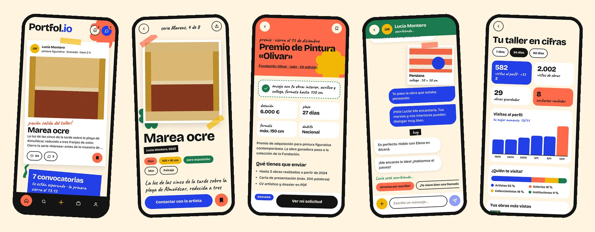

</div>

---

## ¿Qué es Portfol.io?

Las plataformas de arte se centran en vender obra y las redes profesionales generalistas no entienden de pintura. **Portfol.io** reúne en una sola app lo que un pintor profesional necesita para su carrera:

| | |
|---|---|
| 🖼️ **Portfolio con ficha técnica** | Obras con técnica, medidas, año, serie y estado. Las series se recorren en una **sala virtual**. |
| 🤝 **Red profesional** | Conexiones mutuas con artistas, galerías, comisarios e instituciones, y validación de técnicas entre colegas. |
| 🎯 **Convocatorias con encaje** | Cada premio, beca, residencia o exposición indica cuánto **encaja con tu obra**. Te presentas con obras de tu portfolio sin salir de la app. |
| 💬 **Mensajería en tiempo real** | Chat con «escribiendo…», confirmación de lectura, obras adjuntas y respuestas rápidas. |
| 📊 **Estadísticas** | Visitas, vistas de obra, guardados, quién te visita y tus obras más vistas. |
| 🏛️ **Panel para galerías** | Desde la web, las organizaciones publican convocatorias y revisan, preseleccionan y resuelven candidaturas. |

> Es una **red profesional pura**: sin compraventa, para que galerías e instituciones sean aliadas y no competencia.

## Capturas

### App móvil (React Native + Expo)

**Acceso y onboarding**: bienvenida, rol, intereses, registro
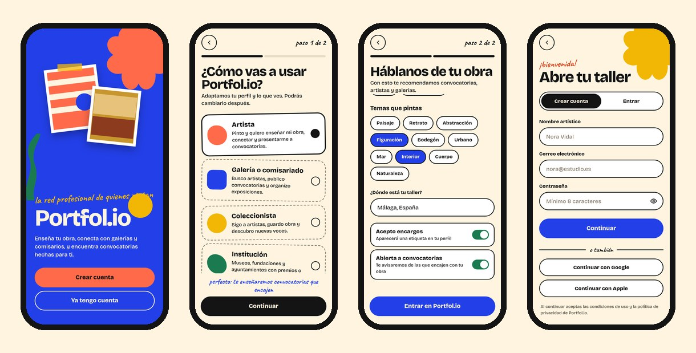

**Descubrir**: muro, búsqueda, filtros con distancia, obra, perfiles y sala virtual
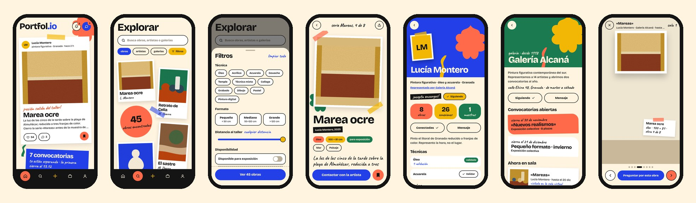

**Convocatorias**: listado por encaje, detalle, solicitud, confirmación y seguimiento
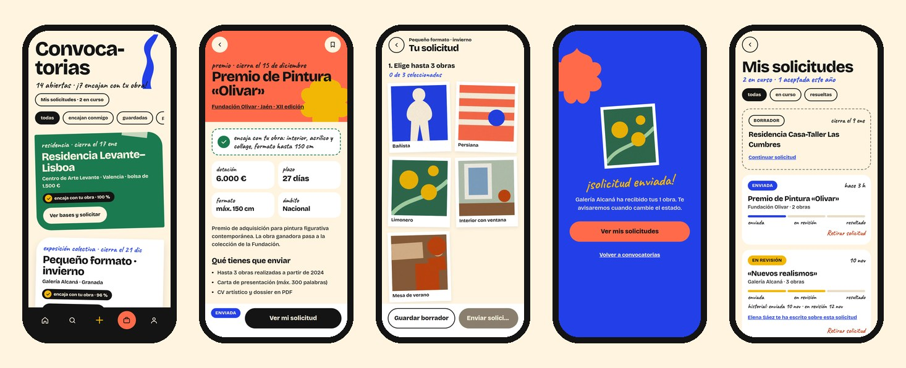

**Red y mensajes**: solicitudes de conexión, bandeja, chat en vivo y avisos
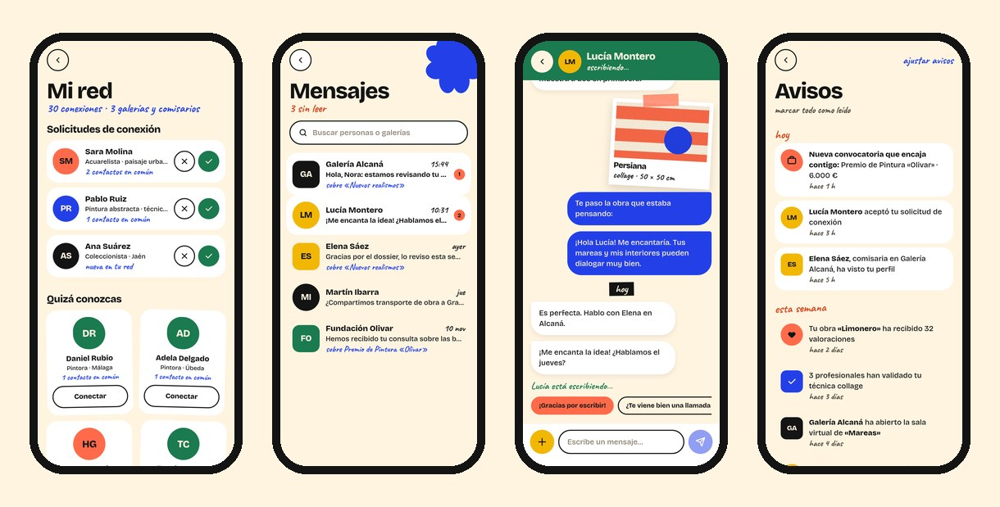

**Mi cuenta**: perfil, edición, estadísticas, publicar obra y ajustes
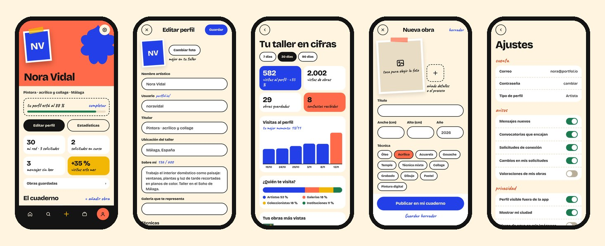

### Web (Next.js)

<table>
<tr>
<td width="50%">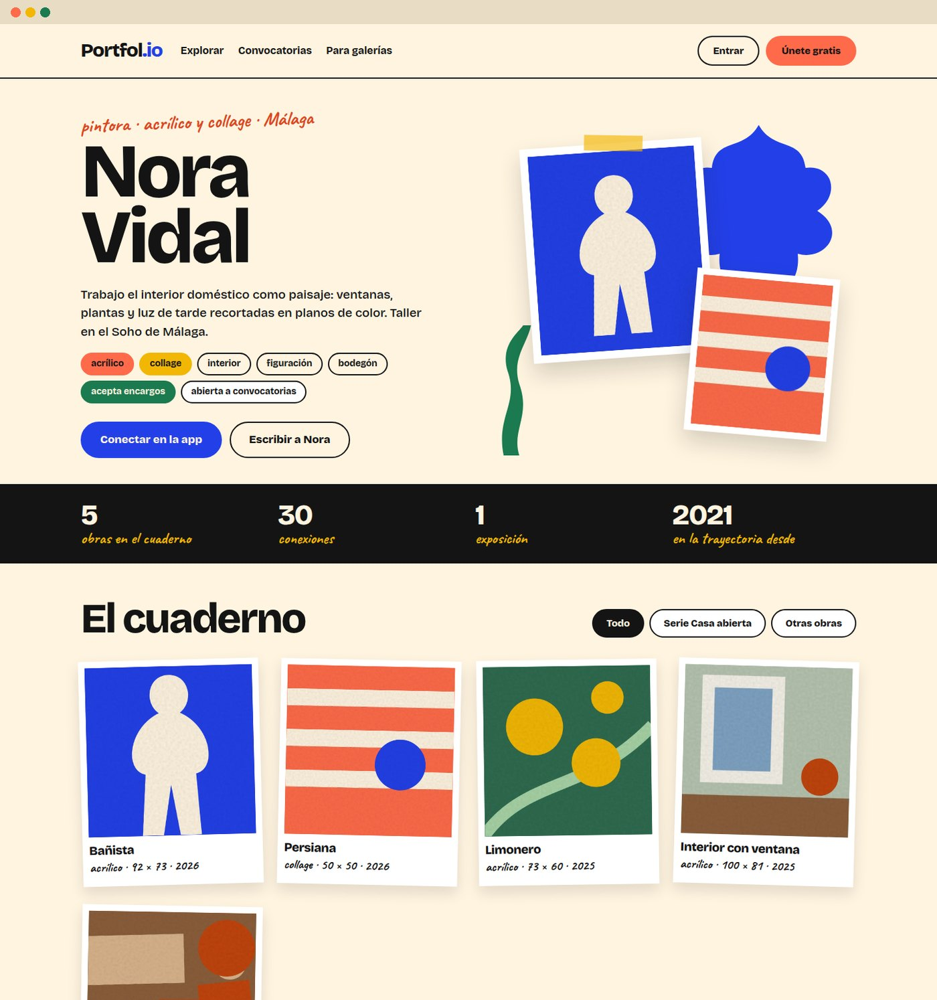<br><sub><b>Portfolio público</b> indexable (SEO, Open Graph, JSON-LD)</sub></td>
<td width="50%">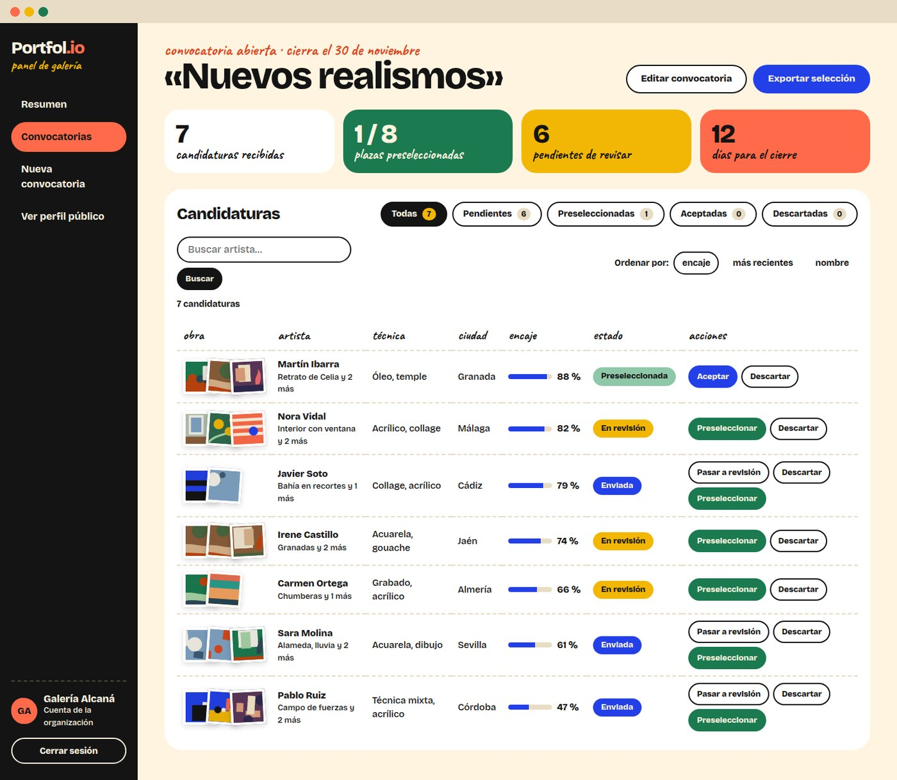<br><sub><b>Panel de organización</b>: candidaturas por encaje, filtros y decisiones</sub></td>
</tr>
<tr>
<td>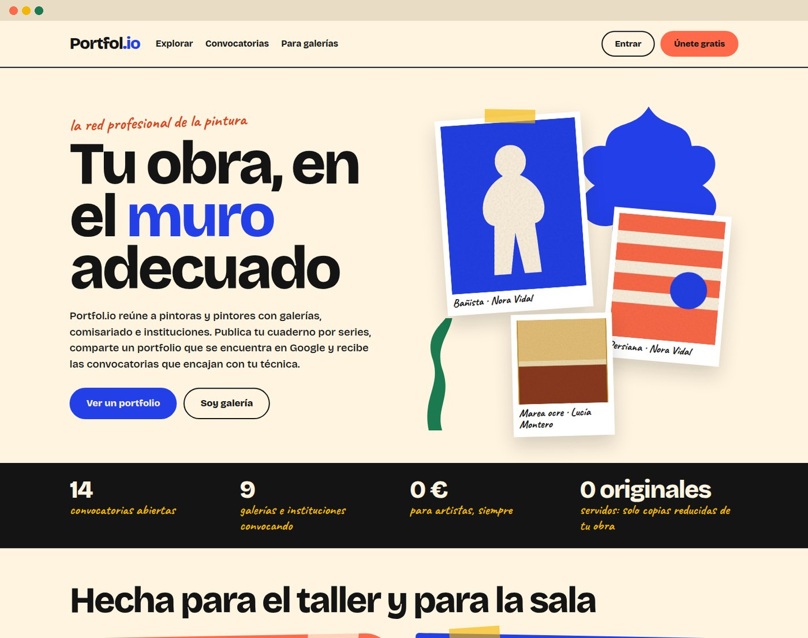<br><sub><b>Página de inicio</b></sub></td>
<td>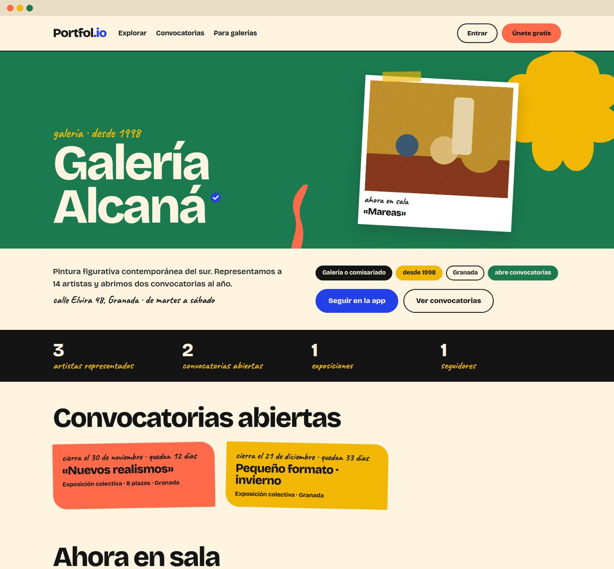<br><sub><b>Perfil de galería</b>: convocatorias, exposición actual y artistas</sub></td>
</tr>
</table>

## Arquitectura

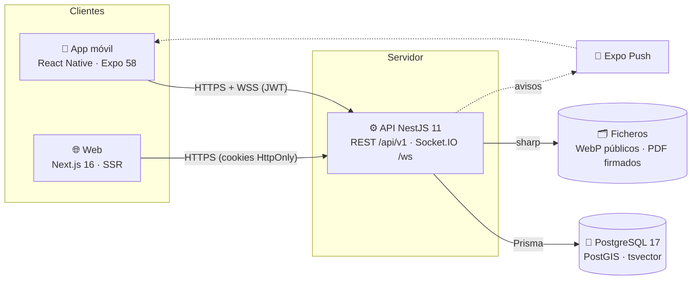

Es un **monorepo TypeScript** (pnpm + Turborepo) en el que las tres aplicaciones comparten **un único contrato**:

```
portfol.io/
├── apps/
│   ├── api/          NestJS · Prisma · PostgreSQL/PostGIS · Socket.IO
│   ├── mobile/       Expo · React Navigation · TanStack Query · Zustand
│   └── web/          Next.js App Router · portfolio público · panel de galerías
└── packages/
    ├── schemas/      Zod + tipos DTO + algoritmo de encaje + máquina de estados
    ├── api-client/   cliente REST tipado con renovación de sesión
    └── tokens/       sistema visual «Recortes» (colores, tipografía, medidas)
```

Un esquema como «la carta de presentación tiene como máximo 300 palabras» se escribe **una sola vez** en `@portfolio/schemas`. Valida en el formulario del móvil, en el de la web y en la API, y TypeScript avisa en las tres aplicaciones si el contrato cambia.

### Algunos detalles técnicos

- **Encaje artista–convocatoria**: `E = 100·(0,40·Jtéc + 0,25·Jtema + 0,20·P + 0,15·R)`, donde J es el índice de Jaccard, P la proximidad por ámbito y R los requisitos formales. Está en [`packages/schemas/src/match.ts`](packages/schemas/src/match.ts) y tiene pruebas unitarias.
- **Búsqueda**: texto completo en español con `tsvector` ponderado, trigramas para tolerar erratas y distancia con PostGIS `ST_DWithin`. Las columnas son generadas, así que se mantienen solas.
- **Seguridad**:
  - Contraseñas con Argon2id.
  - JWT de 15 minutos y **refresh rotativo con detección de reutilización**: si un token robado se usa dos veces, se revoca la sesión entera.
  - Helmet, límite de peticiones y SQL parametrizado.
- **Protección de la obra**: el original **nunca se guarda**. Al subirlo se generan tres variantes WebP (y marca de agua si la artista la activa) y el color dominante para la carga progresiva.
- **Documentos privados**: el CV y el dossier se sirven solo con URL firmadas por HMAC que caducan a los 10 minutos.
- **Tiempo real**: Socket.IO con salas por usuario. Si la destinataria no está conectada, recibe una notificación **push** de Expo, según sus preferencias.
- **Móvil**: actualizaciones optimistas con vuelta atrás, caché sin conexión del perfil y las solicitudes, y compresión de imágenes en el dispositivo.
- **Web**: ISR para los portfolios, rutas interceptadas (la obra se abre en un modal) y sesión con cookies HttpOnly renovadas en el `proxy` de Next 16.

## Puesta en marcha

**Requisitos:** Node.js ≥ 20 (probado con 24), pnpm 11 y Docker.

```bash
pnpm install                         # dependencias de todo el monorepo
pnpm db:up                           # PostgreSQL 17 + PostGIS en Docker (puerto 5434)
cp apps/api/.env.example apps/api/.env
pnpm build:packages                  # tokens, schemas y api-client
pnpm db:migrate && pnpm db:seed      # esquema + datos de demostración (~25 s)

pnpm dev:api      # API     → http://localhost:3000/api/v1   (OpenAPI en /api/docs)
pnpm dev:web      # Web     → http://localhost:3001
pnpm dev:mobile   # Expo    → Expo Go, emulador, o pulsa «w» para abrirla en el navegador
```

> 📱 **En un móvil físico**, la app y las imágenes deben apuntar a la IP de tu ordenador: `EXPO_PUBLIC_API_URL=http://192.168.x.x:3000/api/v1` y `PUBLIC_URL=http://192.168.x.x:3000` en `apps/api/.env`.

### Cuentas de demostración

Contraseña de todas: **`portfolio123`**

| Cuenta | Quién es | Dónde usarla |
|---|---|---|
| `nora@portfol.io` | **Nora Vidal**, pintora en Málaga (acrílico y collage) | App móvil |
| `alcana@portfol.io` | **Galería Alcaná**, Granada | Panel web (`/panel`) |
| `elena@portfol.io` | **Elena Sáez**, comisaria de Alcaná | Panel web |
| `admin@portfol.io` | Administración (moderación y verificación) | API |

Portfolios públicos de ejemplo: [`/noravidal`](http://localhost:3001/noravidal), [`/luciamontero`](http://localhost:3001/luciamontero) y [`/galeriaalcana`](http://localhost:3001/galeriaalcana).

### Con Docker

```bash
docker compose --profile full up --build    # base de datos + API en contenedor
```

## Pruebas y calidad

```bash
pnpm typecheck    # TypeScript estricto en todo el monorepo
pnpm test         # 22 unitarias de dominio + 24 de integración de la API
```

| Suite | Qué cubre | Resultado |
|---|---|---|
| `packages/schemas` | Encaje, transiciones de estado, formatos, validaciones | ✅ 22/22 · 97 % de líneas |
| `apps/api` (integración) | Auth y rotación de tokens, obras e imágenes, red, búsqueda PostGIS, RGPD, ciclo completo de una solicitud, URL firmadas, mensajería en tiempo real | ✅ 24/24 |
| `apps/mobile` | `tsc`, `expo-doctor` 20/20, export web, recorrido E2E en Chromium | ✅ |
| `apps/web` | `tsc`, ESLint, `next build`, recorrido E2E del panel | ✅ |

Las pruebas de integración usan una base de datos propia (`portfolio_test`), que se crea una vez con:

```bash
docker exec portfolio-db psql -U portfolio -c "CREATE DATABASE portfolio_test"
```

La integración continua está en [`.github/workflows/ci.yml`](.github/workflows/ci.yml): instala, compila, comprueba tipos, ejecuta las pruebas contra PostGIS y compila la web y la app.

## Stack

| Capa | Tecnologías |
|---|---|
| **Móvil** | React Native 0.88, Expo SDK 58, React Navigation 7, TanStack Query 5, Zustand 5, React Hook Form + Zod, Socket.IO client, expo-image, react-native-svg |
| **Web** | Next.js 16 (App Router, Server Actions, ISR), React 19, CSS Modules |
| **API** | NestJS 11, Prisma 6, Socket.IO 4, Argon2, JWT, sharp, Helmet, Throttler, Swagger |
| **Datos** | PostgreSQL 17, PostGIS 3.5, pg_trgm, búsqueda de texto completo en español |
| **Calidad** | TypeScript estricto, Vitest + SWC, Supertest, GitHub Actions, Docker |

## Documentación

Este repositorio forma parte de un proyecto académico con dos documentos complementarios:

- 📘 **Especificación**: requisitos (RF/RNF/RN), casos de uso, modelo de datos, diseño visual *Recortes* y mockups.
- 📗 **Desarrollo**: arquitectura implementada, decisiones, algoritmos, pruebas, despliegue y trazabilidad de cada requisito con su código.

Cada aplicación tiene además su propio README: [API](apps/api/README.md) · [móvil](apps/mobile/README.md) · [web](apps/web/README.md).

## Próximos pasos

- [ ] *Development builds* con EAS y pruebas en iOS y Android físicos (push, almacén seguro, selectores nativos).
- [ ] Colas con BullMQ + Redis y almacenamiento S3 + CDN.
- [ ] Acceso con Google y Apple en la app.
- [ ] Interfaz de administración para verificar organizaciones y moderar denuncias.
- [ ] CV y dossier guardados en el perfil, y convocatorias guardadas en el servidor.

---

<div align="center">
<sub>Proyecto de la asignatura <b>Tecnologías y desarrollo en dispositivos móviles</b> · Máster en Ingeniería Informática · Universidad de Jaén · 2026–27<br>
Autor: <b>Alejandro Arroyo Loaisa</b></sub>
</div>
